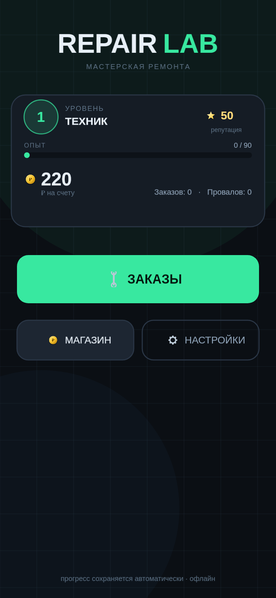
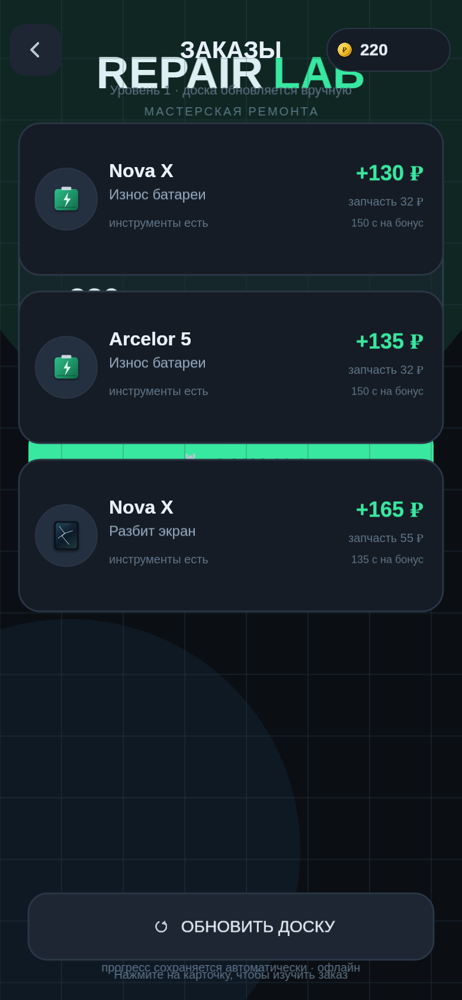
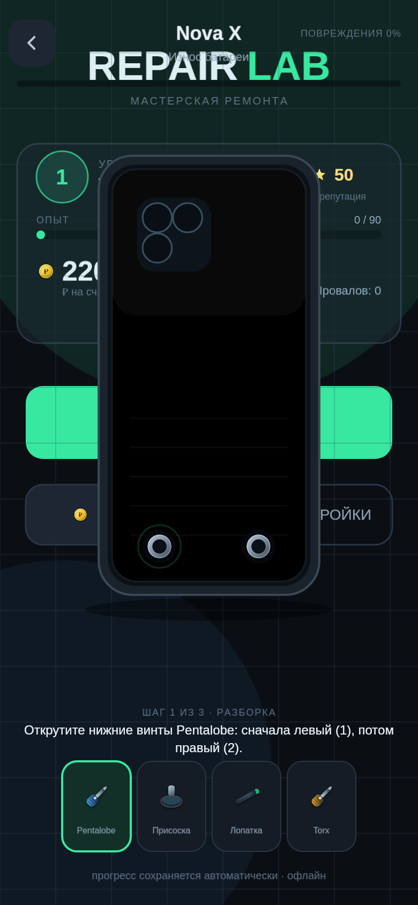
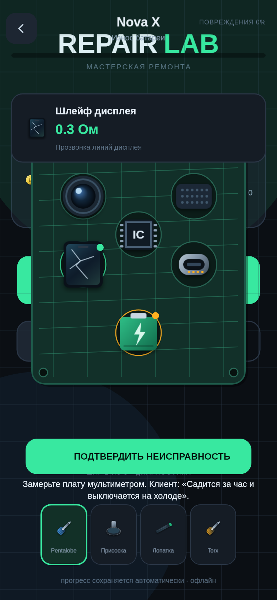
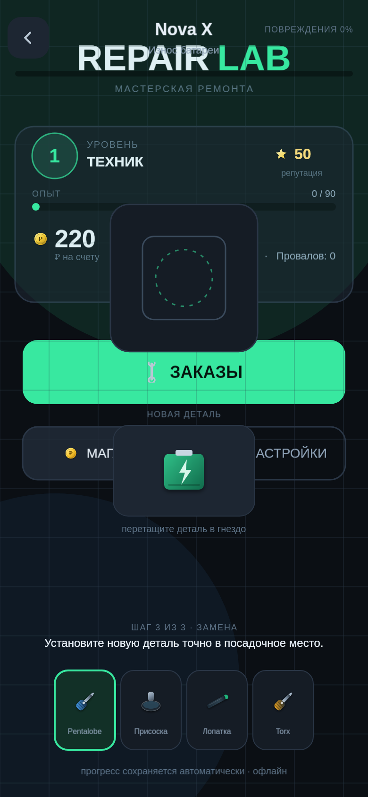
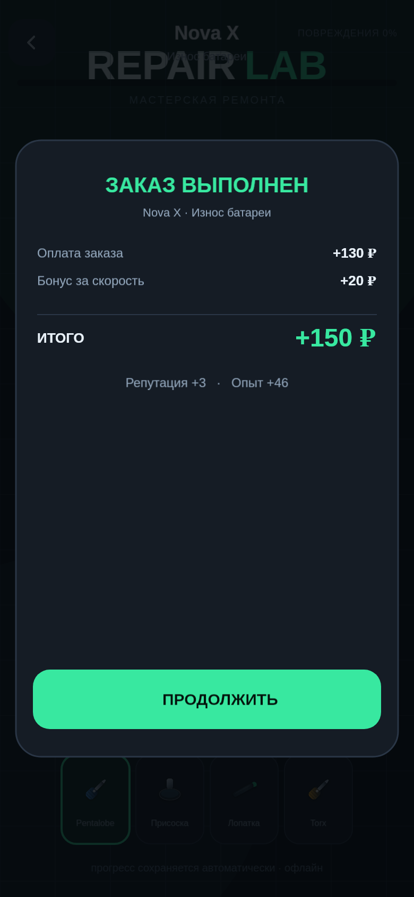
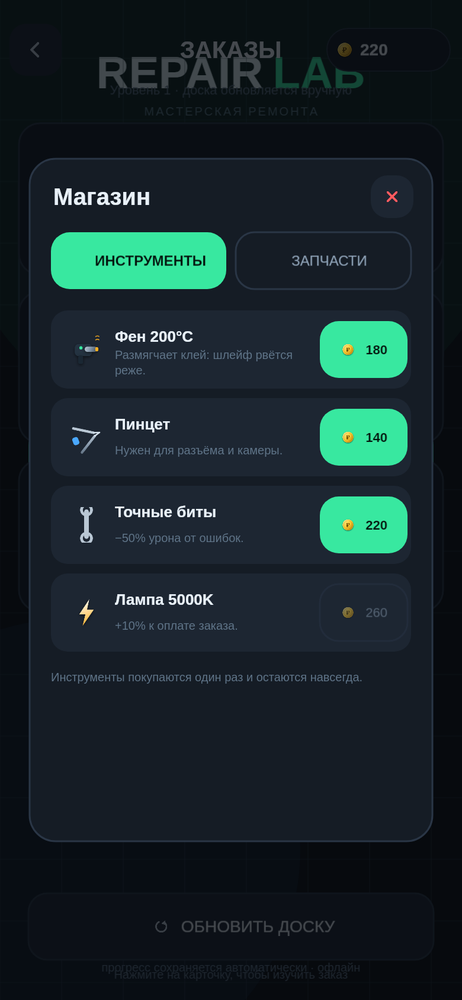
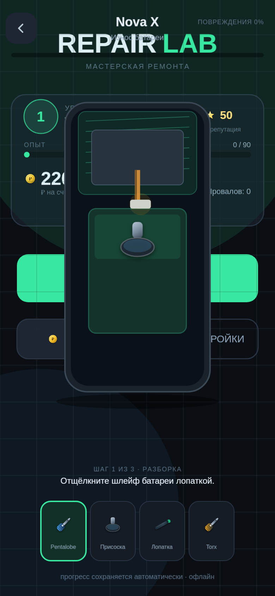
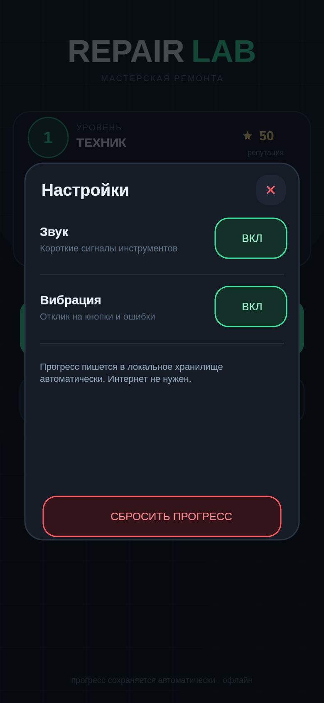

# Repair Lab — мастерская ремонта

Мобильная игра про разборку, диагностику и ремонт телефонов. Тач-управление,
портретная ориентация, офлайн-прогресс, без pay-to-win.

**Стек:** Phaser 3.90 + Vite 8, обёртка под Android/iOS — Capacitor.
Вся графика и звук генерируются в рантайме: в репозитории нет ни одного
бинарного ассета, поэтому проект весит меньше мегабайта и грузится мгновенно.

## Скриншоты

| Главное меню | Доска заказов | Разборка |
|---|---|---|
|  |  |  |

| Диагностика | Замена детали | Итоги заказа |
|---|---|---|
|  |  |  |

| Магазин | Плата открыта | Настройки |
|---|---|---|
|  |  |  |

Скриншоты сняты автоматически из собранного билда (рендер в headless-окружении,
Canvas-рендерер, DPR 2) — это не макеты, а реальный вывод игры.

---

## Что уже играется

| Этап | Механика | Управление |
|------|----------|------------|
| **Разборка** | Винты Pentalobe → присоска → винты Torx → шлейф батареи. Порядок винтов важен, не тот инструмент срывает шлиц | тап по винту + выбор инструмента, перетаскивание инструмента из дока, свайп вверх с контролем скорости |
| **Диагностика** | 6 узлов на плате, мультиметр, «ложный след». Лишние замеры стоят денег | тап по компоненту, пинч-зум двумя пальцами, двойной тап — сброс |
| **Замена** | Попасть деталью в допуск, прижать разъём, включить телефон | drag-and-drop детали, тап по разъёму |
| **Экономика** | Заказы, оплата, штрафы за повреждения, репутация, опыт, уровни | — |
| **Магазин** | Инструменты (фен, пинцет, точные биты, лампа) и запчасти | тапы |

Прогресс сохраняется автоматически в `localStorage` (в Capacitor — в WebView),
при уходе приложения в фон — принудительный `flush`.

## 📲 Готовый APK

Готовый debug-APK собирается автоматически в GitHub Actions и публикуется
релизом — скачать можно без установки Android Studio:

**[⬇ Скачать repair-lab-debug.apk](https://github.com/TheRR-boom/repair-lab/releases/latest)**

1. Откройте ссылку на телефоне (или скачайте на ПК и передайте файл).
2. Разрешите «Установку из неизвестных источников» для браузера/проводника.
3. Откройте скачанный `.apk` → «Установить».

Параметры сборки: `com.repairlab.game`, versionCode 1, minSdk 22 (Android 5.1+),
targetSdk 34, debug-подпись (для Google Play нужен свой keystore и release-сборка).

Сборка запускается сама на каждый push в `main` и вручную через
`Actions → Android APK → Run workflow`. Артефакт хранится 30 дней,
релиз — постоянно.

## Запуск

```bash
npm install
npm run dev        # http://localhost:5173
npm run build      # dist/
npm run preview    # предпросмотр сборки
npm test           # 21 unit-тест логики (node:test, без зависимостей)
```

## Android (Capacitor)

```bash
npm install -D @capacitor/cli @capacitor/core @capacitor/android
npx cap add android
npm run android:sync     # build + copy web в android/
npx cap open android     # Android Studio → Run
```

`capacitor.config.json` уже настроен: `webDir: dist`, `appId com.repairlab.game`.
Для релиза: `versionCode`/`versionName` в `android/app/build.gradle`, иконки —
`npx @capacitor/assets generate`, подпись — `keystore` + `assembleRelease`.

## Структура

```
src/
  main.js                 точка входа: layout, сохранение, звук
  styles.css              Safe Area, запрет скролла/зума/выделения
  game/
    config.js             Phaser-конфиг (Scale.NONE + ручной DPR)
    core/
      layout.js           размеры экрана, DPR, safe area, дизайн-единицы
      atlas.js            генерация атласа иконок (CanvasTexture 1024²)
      ui.js               палитра, кнопки, панели, модалки, тосты
      audio.js            синтез звука на WebAudio + вибрация
      backdrop.js         фон (один раз на перерисовку, не в update)
    data/content.js       инструменты, модели, неисправности, баланс
    systems/
      run.js              вся логика заказа (чистая, без Phaser)
      economy.js          оплата, репутация, уровни, покупки
      save.js             схема сохранения, санитайзер, автозапись
      rng.js              детерминированный ГПСЧ
    scenes/               boot, menu, orders, repair
    views/                teardown, diagnose, replace (этапы ремонта)
tests/logic.test.js       21 тест: разборка, диагностика, экономика, save
```

## Мобильные правила, которые соблюдены

- **Только тач:** тапы, drag-and-drop, свайп с контролем скорости, пинч-зум.
  Нет ни одного действия, требующего клавиатуры, правой кнопки или hover.
- **Зоны нажатия ≥ 44 dp:** кнопки 48–68 dp, док 84 dp, зона винта 64 dp
  (сам винт нарисован 30 dp — палец не целится в пиксель).
- **Safe Area:** `viewport-fit=cover` + `env(safe-area-inset-*)` на контейнере;
  игра портретная, в ландшафте — честная заглушка «поверните телефон».
- **Адаптивность:** canvas в физических пикселях (DPR до 2.5, бюджет 2.3 Мп),
  вёрстка в дизайн-единицах 390×844, экран всегда ≥ 844 единиц по высоте.
- **Производительность:** один атлас на все иконки, нет `Instantiate`/спавна
  в цикле, нет polling в `update()`, таймеры и события Phaser, фон рисуется
  один раз, твины останавливаются при перерисовке.
- **Память:** ассетов на диске нет; текстуры создаются один раз.
- **Батарея:** нет тяжёлых шейдеров и постоянного `update()`, звук — короткие
  синтезированные сигналы.
- **Офлайн:** вся логика локальная, сеть не используется.
- **Звук/вибрация:** отключаются в настройках, состояние сохраняется.
- **Автосохранение:** debounce 250 мс + flush при `pagehide`/`visibilitychange`.

## Тесты

```bash
npm test
```

Покрыто: порядок винтов, срыв шлица, рывок и разрыв шлейфа, фен, отключение
шлейфа, замеры и подтверждение неисправности, допуск при установке, включение,
оплата/штрафы/репутация/уровни, санитайзер сохранения, генерация заказов.

Помимо юнит-тестов логики, вёрстка проверена автоматическим layout-линтом
по собранному бандлу на трёх форматах (390×844, 360×640, 768×1024):
тексты не выходят за экран, элементы не наезжают друг на друга,
все интерактивные зоны ≥ 44 dp. На момент коммита — 0 замечаний.

## Известные ограничения (честно)

- Одна модель разборки для всех неисправностей; различаются набор инструментов,
  компонент на плате и заменяемая деталь.
- Нет серверной части и облачных сейвов — только локально.
- iOS-сборка не проверялась: в окружении разработки нет macOS.
- Код проверен юнит-тестами и layout-линтом; визуальная проверка на живом
  устройстве ещё нужна (см. «Следующий шаг»).

## Лицензия

MIT — см. [LICENSE](./LICENSE).